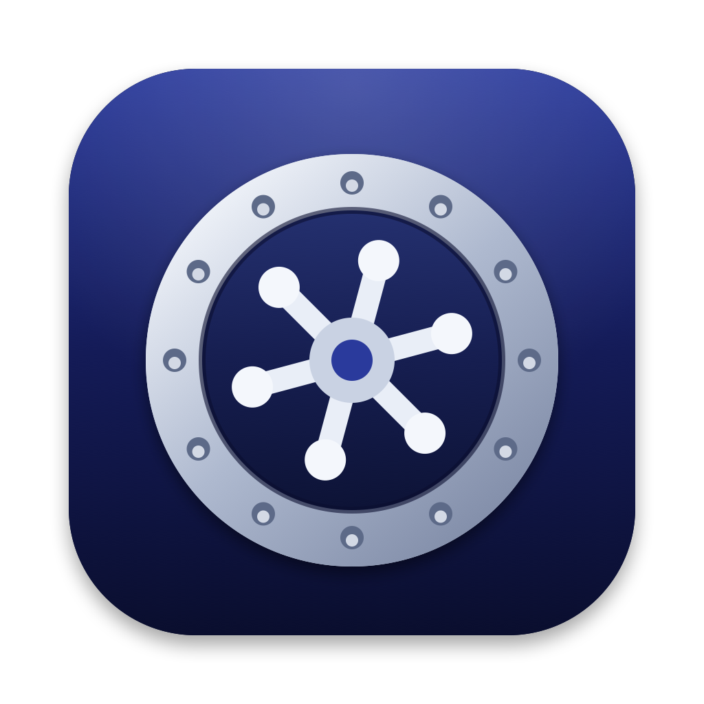
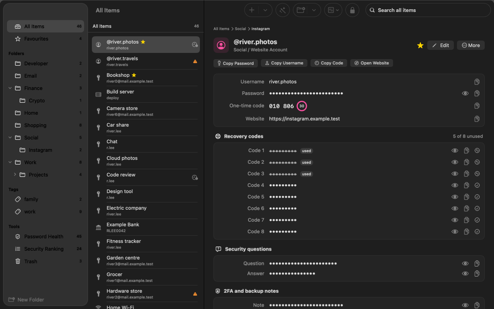
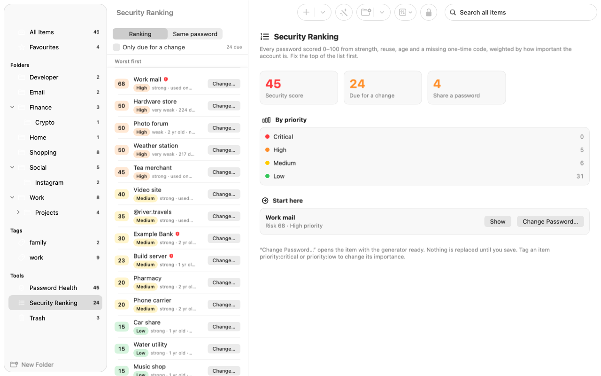
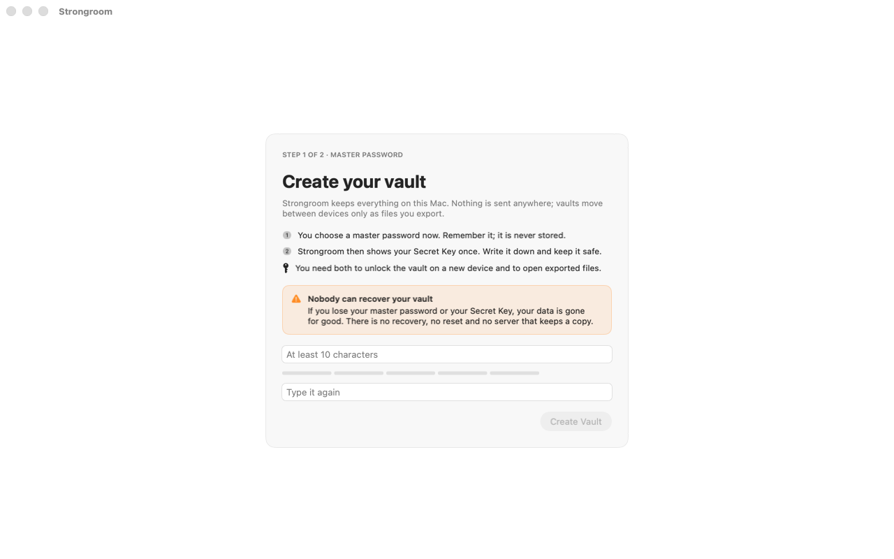

<p align="center"></p>

# Strongroom

[](https://github.com/myselfRaifMondal/strongroom/actions/workflows/rust.yml)
[](https://github.com/myselfRaifMondal/strongroom/actions/workflows/macos.yml)
[](https://github.com/myselfRaifMondal/strongroom/actions/workflows/windows.yml)
[](https://github.com/myselfRaifMondal/strongroom/actions/workflows/android.yml)
[](https://github.com/myselfRaifMondal/strongroom/actions/workflows/crossplatform.yml)
[](LICENSE)
[](https://github.com/myselfRaifMondal/strongroom/labels/good%20first%20issue)
[](https://github.com/myselfRaifMondal/strongroom/labels/help%20wanted)
[](https://github.com/myselfRaifMondal/strongroom/discussions)

A device-first, local-only password manager. Your vault lives encrypted on
your own devices. There is **no server, no account and no cloud sync**:
vaults move between devices only as encrypted files you transfer yourself.

One Rust security core does all the cryptography; each platform has a
native app on top of it.

<p align="center">
  
</p>

<p align="center">
  
  
</p>
<p align="center"><sub>Screenshots use made-up test data.</sub></p>

**Want to help?** Strongroom is young and has room for contributors at every
level: Rust, Swift, Kotlin, C#, Python, CI, docs and testing on real devices.
Start with a [good first issue](https://github.com/myselfRaifMondal/strongroom/labels/good%20first%20issue),
read [CONTRIBUTING.md](CONTRIBUTING.md), or say hello in
[Discussions](https://github.com/myselfRaifMondal/strongroom/discussions).
If you find the project useful, a star helps other people find it.

| Platform | App | Status |
|----------|-----|--------|
| macOS    | SwiftUI (`apps/macos`) | Usable; built with SwiftPM, no Xcode needed |
| Windows  | WinUI 3 (`apps/windows`) | Builds and runs in CI; not yet hand-tested. Installers (x64, ARM64): [install guide](apps/windows/INSTALL.md) |
| Android  | Jetpack Compose (`apps/android`) | Runs on emulator; not yet hand-tested on devices |
| iOS      | — | Deferred (see [OQ-14](docs/OPEN-QUESTIONS.md)) |

**Download:** [Strongroom 0.1.0 pre-release](https://github.com/myselfRaifMondal/strongroom/releases/tag/v0.1.0)
for Windows (x64, ARM64), Android and macOS (Apple Silicon). The release
notes explain the one-time security prompts on each platform.

> **Pre-release software.** It has not had an independent security audit.
> Publishing the source code lets people review it; it does not by itself
> make the software secure. Keep a copy of your passwords elsewhere until it
> has been audited.

## What it does

- Logins, secure notes, cards, identities, API keys, SSH keys, with custom
  fields, folders (as a tree), tags, favourites, search, item history and
  trash.
- Templates for things worth protecting: bank accounts, Wi-Fi, passports
  and IDs, recovery codes, crypto seed phrases, licences, servers and more.
- Several accounts per service, each with its own password and recovery
  codes (for example *Social › Instagram › @personal, @work*).
- Built-in TOTP codes, password and passphrase generator, strength meter.
- Security ranking: every password scored by strength, reuse, age and how
  important the account is, plus reminders to rotate them.
- Organize by service: files logins into a folder tree automatically.
- Touch ID / Windows Hello / Android biometrics via a hardware-held key; the
  master password is still required regularly.
- Import from Apple Passwords, Bitwarden, 1Password, LastPass and Chrome.
- Encrypted export/import between devices (the frozen **VTF** format),
  device pairing by QR code, travel mode and a decoy vault. The Windows app
  cannot pair with other devices yet, so it exports and imports with the
  master password and Secret Key only
  ([#52](https://github.com/myselfRaifMondal/strongroom/issues/52)).
- Clipboard auto-clear, screen-capture exclusion, confirmed auto-type and a
  global quick-access overlay on desktop.
- macOS: keeps running in the menu bar after its window closes (optionally
  opened at login), so the quick-access shortcut (⌥⌘\) always works. It
  locks before the Mac sleeps, when the screen locks, on user switching and
  optionally after inactivity; the shortcut then asks for Touch ID or the
  master password and Secret Key.
- Windows: locks when Windows locks (Win+L), on user switching, before
  sleep and optionally after inactivity (off by default).
- No network access at all (an opt-in breach check is planned and will be
  off by default).

## Security design

These are design goals and the checks that test them, not a guarantee.

- Master password **and** a 128-bit Secret Key are both needed to open a
  vault. Argon2id (256 MiB, t=3, p=4) + HKDF-SHA-256, XChaCha20-Poly1305,
  HPKE with P-256 for device-bound files, SQLCipher for the local store.
- No new cryptographic primitives: it composes existing, widely used
  RustCrypto crates (not all of which have had third-party audits).
- The file format is specified byte-for-byte in
  [docs/SPEC-VTF.md](docs/SPEC-VTF.md), with positive and negative test
  vectors in [vectors/](vectors/) and an independent Python reference
  implementation in [reference/](reference/) that reproduces them.
- Fuzzing, property tests, `cargo-audit` and cross-platform round-trip tests
  run in CI.
- Threat model: [docs/THREAT-MODEL.md](docs/THREAT-MODEL.md).
  Reporting vulnerabilities: [docs/SECURITY.md](docs/SECURITY.md).

**There is no recovery.** If you lose your master password or your Secret
Key, your vault cannot be opened by anyone, including the developers.

## Known limitations

- **No independent security audit** yet.
- **macOS:** the app is ad-hoc signed and not notarized, so other Macs show
  a Gatekeeper warning on first launch, and weekly reminder notifications are
  unavailable (reminders appear as a banner on unlock instead). "Open at
  login" may need approval in System Settings › Login Items and has not been
  verified for the ad-hoc build ([OQ-M10](docs/OPEN-QUESTIONS.md)). While it
  runs unlocked in the background, the vault key stays in the app's memory.
  Built for macOS 14+, but only run on macOS 26.
- **Windows:** built and tested only on GitHub Actions runners. Windows Hello
  and the TPM-backed key have not been tested on real hardware, and the app
  enforces the Hello prompt rather than the TPM ([OQ-W1](docs/OPEN-QUESTIONS.md)).
  The app locks on Win+L, user switching, sign-out and before sleep, and
  optionally after 5-60 minutes without use (off by default); these locks
  are tested only with simulated messages in CI ([OQ-W7](docs/OPEN-QUESTIONS.md)).
- **Android:** tested on an emulator only. Autofill on real forms is
  untested, and biometric unlock uses a 10-second authorisation window rather
  than per-use binding ([OQ-9](docs/OPEN-QUESTIONS.md)). Device-key features
  need Android 12 (API 31) or later.
- **iOS:** not available.
- **Memory:** passwords passing through Swift, Kotlin or C# strings cannot be
  reliably wiped, and SQLite's page cache is not wiped on free
  ([OQ-12](docs/OPEN-QUESTIONS.md)).
- **Rollback:** replacing the local vault files with an older copy is not
  detected.
- **Breach checking** (Have I Been Pwned) is not implemented yet.
- Full list of open design questions: [docs/OPEN-QUESTIONS.md](docs/OPEN-QUESTIONS.md).

## Build the macOS app

Needs the Rust toolchain and the Xcode Command Line Tools (full Xcode is not
required).

```bash
apps/macos/scripts/build-core.sh   # Rust core + Swift bindings (first run ~10 min)
apps/macos/scripts/build-app.sh    # SwiftUI app, ad-hoc signed
open apps/macos/out/Strongroom.app
```

Other platforms: see `apps/windows/` and `apps/android/`, and the CI
workflows in `.github/workflows/`.

## Repository layout

| Path | What |
|------|------|
| `crates/vtf-core` | The VTF transfer format: key hierarchy, chunked AEAD, strict CBOR |
| `crates/vault-core` | Encrypted local store, items, merge, TOTP, generator, audit, CSV import |
| `crates/strongroom-ffi` | The stable FFI contract (UniFFI) used by every app |
| `apps/` | Native apps for macOS, Windows, Android |
| `apps/macos/CLI.md` | The headless `strongroom-mac-cli`: build, environment variables, one example per command |
| `vectors/` | Normative test vectors for VTF1 |
| `reference/` | Independent Python reference implementation |
| `fuzz/` | cargo-fuzz targets |
| `docs/` | Spec, architecture, threat model, security policy, open questions |

## Roadmap

Rough order, not promises. Each line links to its tracking issue.

- **Now:** a first pre-release with downloads for every platform
  ([#28](https://github.com/myselfRaifMondal/strongroom/issues/28)), signed
  builds ([#18](https://github.com/myselfRaifMondal/strongroom/issues/18),
  [#27](https://github.com/myselfRaifMondal/strongroom/issues/27)) and
  testing on real phones and PCs
  ([#16](https://github.com/myselfRaifMondal/strongroom/issues/16),
  [#17](https://github.com/myselfRaifMondal/strongroom/issues/17),
  [#32](https://github.com/myselfRaifMondal/strongroom/issues/32)).
- **Next:** feature parity on Windows and Android
  ([#21](https://github.com/myselfRaifMondal/strongroom/issues/21),
  [#51](https://github.com/myselfRaifMondal/strongroom/issues/51),
  [#52](https://github.com/myselfRaifMondal/strongroom/issues/52)), better
  importers ([#53](https://github.com/myselfRaifMondal/strongroom/issues/53))
  and accessibility
  ([#24](https://github.com/myselfRaifMondal/strongroom/issues/24),
  [#54](https://github.com/myselfRaifMondal/strongroom/issues/54)).
- **Later:** an opt-in breach check
  ([#20](https://github.com/myselfRaifMondal/strongroom/issues/20)), iOS
  ([#22](https://github.com/myselfRaifMondal/strongroom/issues/22)) and an
  independent security review
  ([#12](https://github.com/myselfRaifMondal/strongroom/issues/12)).

## Contributing

Contributions are welcome. The most valuable help right now:

- **Security review** of the format spec, the Rust core and the FFI
  boundary. Report findings privately (see below).
- **Testing on real hardware**: Windows Hello / TPM, Android devices and
  autofill, older macOS versions.
- **Independent implementations** of [SPEC-VTF](docs/SPEC-VTF.md) checked
  against [vectors/](vectors/). Disagreements with the spec are bugs worth
  reporting.
- **Fuzzing** for longer than the 60-second CI smoke runs.
- Issues labelled
  [good first issue](https://github.com/myselfRaifMondal/strongroom/labels/good%20first%20issue).

Start with [CONTRIBUTING.md](CONTRIBUTING.md): setup for each platform, the
project rules and the pull request checklist.

**Report vulnerabilities privately** with
[Report a vulnerability](https://github.com/myselfRaifMondal/strongroom/security/advisories/new),
never in a public issue.

## Licence

Strongroom is free software, licensed under the
[GNU General Public License v3.0 or later](LICENSE). If you distribute a
modified version, you must publish its source under the same licence.
Third-party notices: [crates/vault-core/NOTICE](crates/vault-core/NOTICE).
